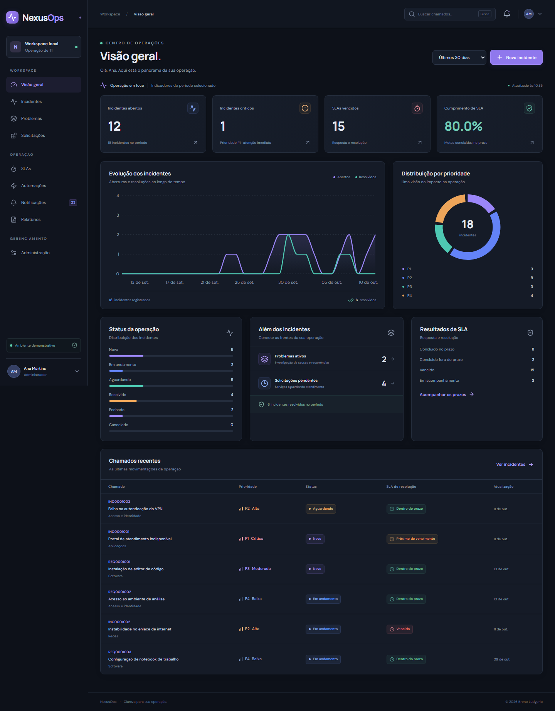
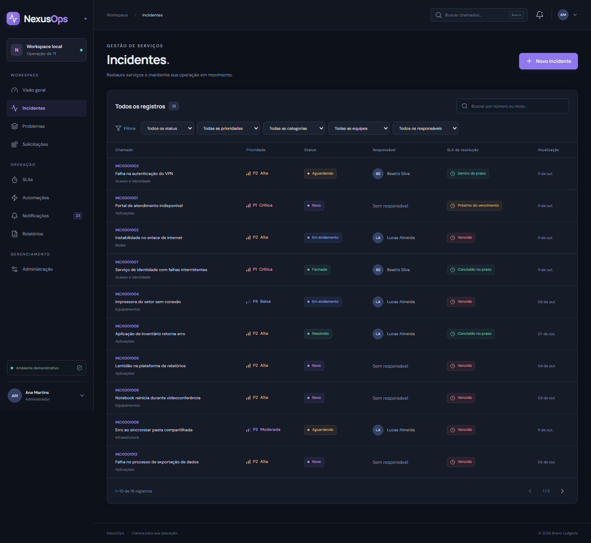
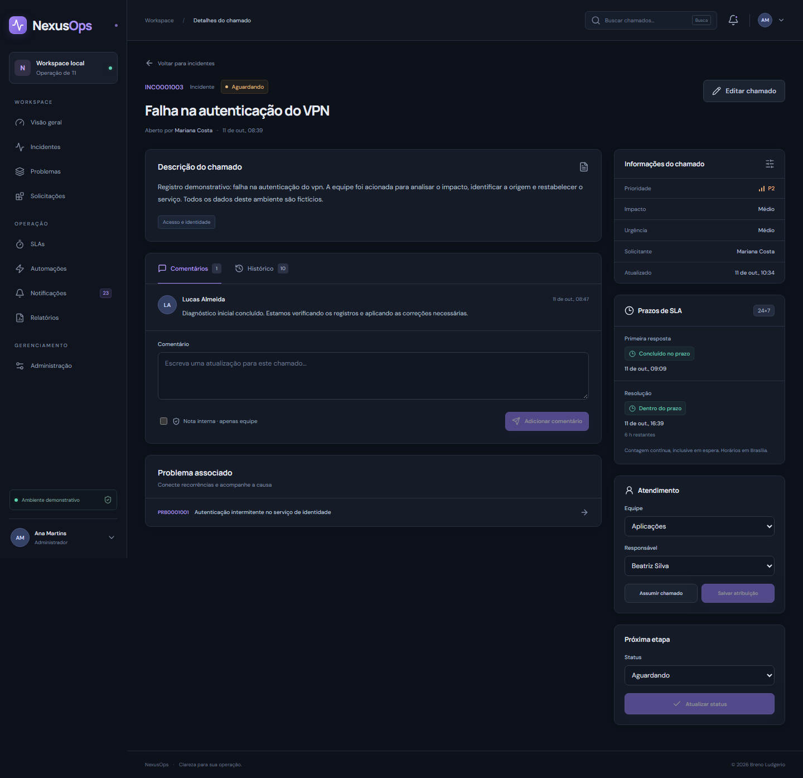
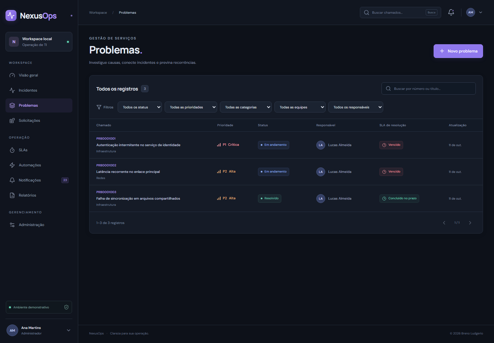
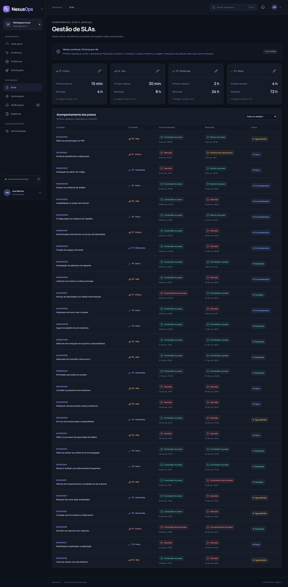
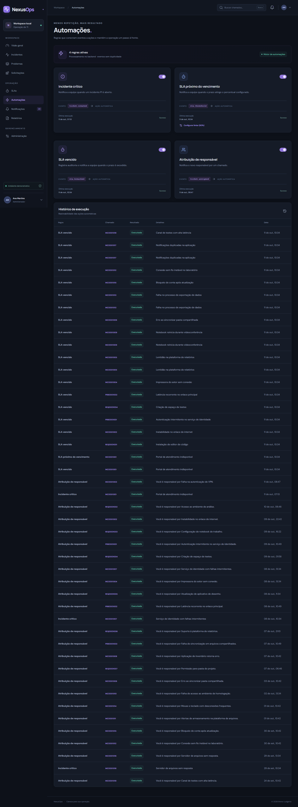
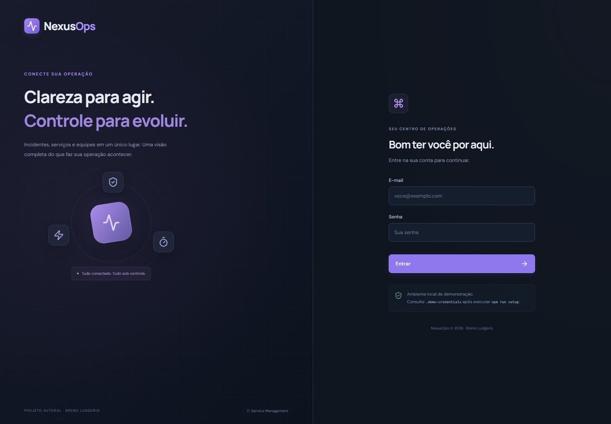
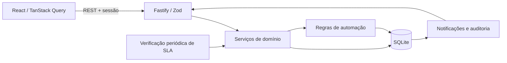

# NexusOps

[](https://github.com/ludgerios/nexusops/actions/workflows/ci.yml)

**Uma plataforma Full Stack de IT Service Management, por Breno Ludgerio.**

O NexusOps organiza incidentes, problemas e solicitações em uma operação de suporte com responsáveis, prazos, notificações e histórico. A interface em português consulta uma API autenticada e todos os registros de operação ficam em um banco SQLite local.

Projeto autoral e independente de portfólio. Os usuários, os chamados e as metas de serviço do seed são fictícios. O projeto utiliza conceitos públicos de gestão de serviços; não reproduz sistemas, materiais ou informações internas de empresas.

## Executar no Windows

Pré-requisitos: **Node.js 24 LTS, a partir de 24.15.0**, npm e Git. Instale a linha 24 pelo [site oficial do Node.js](https://nodejs.org/en/download) e abra uma nova janela do PowerShell após a instalação. O projeto fixa essa linha porque usa o módulo integrado `node:sqlite`.

```powershell
node --version
npm --version
git clone https://github.com/ludgerios/nexusops.git
Set-Location nexusops
npm install
npm run setup
npm run dev
```

| Serviço     | Endereço                     |
| ----------- | ---------------------------- |
| Interface   | http://localhost:5173        |
| API         | http://localhost:3001        |
| Diagnóstico | http://localhost:3001/health |

`setup` cria `.env` somente se ele não existir, aplica migrations versionadas e insere o seed. Configurações personalizadas existentes são preservadas. `dev` inicia a API e o frontend; a API permanece vinculada ao loopback no padrão local. As portas precisam estar disponíveis.

Para interromper, pressione **Ctrl+C** no terminal. Para reiniciar, execute `npm run dev` novamente. O processo não continuará ativo automaticamente depois de fechar o terminal ou encerrar uma sessão remota.

### Contas de demonstração

O seed gera uma senha aleatória local e a grava no arquivo **`.demo-credentials`**, ignorado pelo Git. Para consultá-la no seu computador:

```powershell
Get-Content -LiteralPath .demo-credentials
```

| E-mail                       | Perfil        |
| ---------------------------- | ------------- |
| `admin@nexusops.local`       | Administrator |
| `agente@nexusops.local`      | Support Agent |
| `solicitante@nexusops.local` | Requester     |

Use a senha indicada no arquivo. Os dados adicionais do seed também são fictícios. Executar `setup` ou `seed` novamente não substitui o banco existente por uma nova demonstração.

Para restaurar uma demonstração nova, pare a aplicação e execute:

```powershell
npm run demo:reset -- --confirm
npm run dev
```

Esse comando move o banco anterior e as credenciais para backups locais com data no nome, preserva `.env` e cria uma nova base demonstrativa. Ele permite apenas um banco dentro de `data/` e bloqueia o ambiente produtivo. Leia as novas credenciais antes de entrar.

## Funcionalidades

- Login, logout, sessões persistidas e autorização por perfil no backend.
- Incidentes com prioridade calculada, filtros, paginação, atribuição, comentários, notas internas e histórico.
- Problemas com investigação, causa raiz, workaround e associação persistida a incidentes.
- Solicitações de serviço com tipo próprio e acompanhamento de atendimento.
- SLAs de primeira resposta e resolução em contagem contínua 24x7, com políticas configuráveis.
- Regras predefinidas de automação, avisos deduplicados e histórico de execução.
- Centro de notificações interno com leitura e acesso ao chamado relacionado.
- Dashboard e relatórios alimentados pelo banco, com filtro de período.
- Administração de usuários, equipes, matriz de prioridade, SLAs e regras conforme autorização.
- Interface responsiva, navegação mobile, labels de formulário e suporte a redução de movimento.

A [documentação de domínio](docs/domain.md) define prioridade, transições, SLA e permissões. A cobertura executada e os limites de verificação estão no [registro de qualidade](docs/quality.md).

## Tecnologias

| Camada       | Implementação                                                        |
| ------------ | -------------------------------------------------------------------- |
| Frontend     | React, TypeScript, Vite, TanStack Query, Recharts e Lucide           |
| Backend      | Node.js 24, TypeScript, Fastify e Zod                                |
| Dados        | SQLite em arquivo, driver `node:sqlite`, migrations SQL e transações |
| Autenticação | `scrypt`, sessão em banco, cookie HttpOnly e token CSRF              |
| Qualidade    | Vitest, Fastify `inject`, Playwright, ESLint e TypeScript            |
| Organização  | npm workspaces e monólito modular                                    |
| CI           | GitHub Actions com banco descartável e navegador Chromium            |

O acesso direto ao SQLite evita instalar um serviço de banco ou compilar um driver externo no Windows. `node:sqlite` é classificado como release candidate a partir do Node 24.15.0; a [decisão de arquitetura](docs/architecture/README.md) explica essa escolha, o limite de carga e a futura migração para PostgreSQL.

## Capturas reais

As imagens são produzidas com Playwright a partir da aplicação em execução e de registros persistidos pelo seed. Para reproduzir as capturas após o setup:

```powershell
npx playwright install chromium
$env:E2E_UPDATE_SCREENSHOTS = '1'
npx playwright test e2e/screenshots.spec.ts
Remove-Item Env:E2E_UPDATE_SCREENSHOTS
```

| Dashboard                                    | Incidentes                                             |
| -------------------------------------------- | ------------------------------------------------------ |
|  |  |

| Detalhe do incidente                                 | Problemas                                   |
| ---------------------------------------------------- | ------------------------------------------- |
|  |  |

| SLAs                               | Automações                                      |
| ---------------------------------- | ----------------------------------------------- |
|  |  |



[Ver o dashboard em tela mobile de 390 px](docs/screenshots/dashboard-mobile.png).

## Arquitetura



O agendador roda dentro da API a cada 30 segundos por padrão. Ele usa prazos UTC persistidos, registra execução e evita avisos repetidos. Não depende de uma página aberta. A aplicação deve estar ativa para emitir novos avisos; os estados de prazo continuam calculáveis pelos timestamps depois de reiniciar.

Consulte [arquitetura](docs/architecture/README.md), [API](docs/api.md), [segurança](docs/security.md) e [operação local](docs/windows.md).

## Testes e comandos

```powershell
npm run typecheck
npm run lint
npm run format:check
npm audit --audit-level=moderate
npm test
npm run build
npm run test:restart
npm run db:migrate
npx playwright install chromium
npm run test:e2e
```

Execute `npm run setup` antes dos E2E. Playwright inicia `npm run dev` automaticamente ou reutiliza a aplicação local já ativa. Em CI, utiliza um processo novo. Os testes E2E criam chamados no banco demonstrativo local; use uma cópia descartável se precisar preservar um cenário.

Para testar a interface compilada servida por uma API já ativa, defina `$env:E2E_BASE_URL = 'http://localhost:3001'` antes de `npm run test:e2e` e remova a variável depois com `Remove-Item Env:E2E_BASE_URL`. Nesse modo, Playwright utiliza o endereço informado e não inicia outro servidor. As capturas comuns ficam em `test-results/screenshots`; somente `E2E_UPDATE_SCREENSHOTS=1` atualiza as imagens da documentação.

Para experimentar o build local, pare o modo de desenvolvimento, execute `npm run build` e depois `npm start`. A API compilada serve a interface em **http://localhost:3001**, além das rotas da API. Esse comando usa a configuração local existente e não publica a aplicação.

| Comando                           | Objetivo                                                    |
| --------------------------------- | ----------------------------------------------------------- |
| `npm run setup`                   | Preparar ambiente, migrations e seed                        |
| `npm run dev`                     | Iniciar API e frontend                                      |
| `npm run build`                   | Compilar API e frontend                                     |
| `npm start`                       | Iniciar a API compilada e servir o build do frontend        |
| `npm test`                        | Testes unitários e de integração da API                     |
| `npm run test:e2e`                | Jornadas no Chromium, responsividade e screenshots          |
| `npm run test:restart`            | Verificar registros e sessão após reiniciar a API compilada |
| `npm run typecheck`               | Verificar contratos e TypeScript dos workspaces             |
| `npm run lint`                    | Verificar código com ESLint                                 |
| `npm run db:migrate`              | Aplicar migrations pendentes de forma idempotente           |
| `npm run seed`                    | Inserir demonstração quando a base ainda estiver vazia      |
| `npm run demo:reset -- --confirm` | Preservar backup e criar nova demonstração                  |

O workflow [NexusOps CI](.github/workflows/ci.yml) executa instalação reproduzível, auditoria de dependências, preparação de banco, reaplicação de migrations, TypeScript, lint, formatação, testes, build, persistência após reinício e E2E em Windows e Ubuntu, em pushes para `main` e Pull Requests. Consulte o [status remoto e o histórico de execuções](https://github.com/ludgerios/nexusops/actions/workflows/ci.yml) e o [registro dos testes locais executados](docs/quality.md).

## Segurança e limites

Senhas usam hash `scrypt` com salt aleatório; cookies de sessão são HttpOnly e SameSite; as mutações exigem CSRF. A API valida payloads e aplica permissões aos registros. Requesters acessam somente seus chamados e não recebem notas internas.

O padrão local usa HTTP em loopback. Produção exige HTTPS, cookie Secure, configuração adequada de origem e substituição das contas fictícias. `.env`, bancos, backups e `.demo-credentials` não pertencem ao repositório. Consulte os controles e limites completos em [segurança](docs/security.md).

SQLite atende a demonstração local com baixo volume. Calendário comercial, pausa de SLA, integrações externas, anexos e múltiplas organizações não estão implementados. Não há deploy público da aplicação nesta entrega.

## Roadmap

- Migração testada para PostgreSQL e acesso a dados assíncrono para maior carga.
- Calendários e pausas de SLA com intervalos persistidos.
- SSO, MFA e recuperação de senha com fluxo de identidade.
- Anexos com validação, armazenamento e controle de acesso.
- Métricas de observabilidade, testes de carga e backup automatizado.
- Integrações externas e editor visual de automações, conforme necessidade real.

## Autoria e direitos

**Breno Ludgerio** — [github.com/ludgerios](https://github.com/ludgerios).

Projeto autoral de portfólio de engenharia de software. **Todos os direitos reservados** aos componentes originais. A publicação para avaliação não concede uma licença open source permissiva. Bibliotecas e fontes de terceiros conservam suas licenças. Consulte [LICENSE.md](LICENSE.md) e os [avisos de terceiros](docs/third-party.md).
