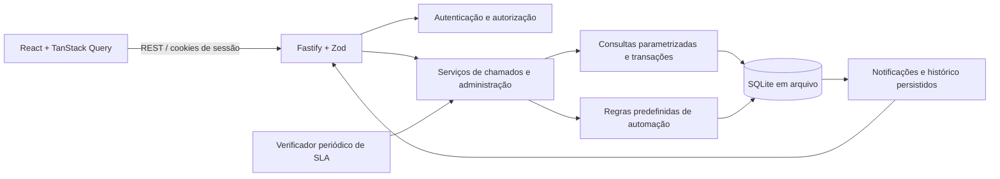

# Arquitetura

NexusOps é um monólito modular para demonstração local. Os workspaces separam interface, API e contratos compartilhados; não exigem serviços externos para autenticação, banco ou notificações.



## Decisões

**SQLite e `node:sqlite`.** A aplicação utiliza o driver integrado ao Node.js 24 e migrations SQL versionadas. Isso reduz instalação de binários externos no Windows e permite inspecionar as constraints diretamente. A API `node:sqlite` é classificada como release candidate (estabilidade 1.2) a partir do Node 24.15.0; o runtime é fixado na linha 24 e deve ser atualizado com testes. Consulte a [documentação oficial do Node 24.15.0](https://nodejs.org/download/release/v24.15.0/docs/api/sqlite.html). Operações síncronas são adequadas ao pequeno volume demonstrativo, mas podem bloquear o event loop sob carga elevada.

**Migração futura.** SQLite é a única base implementada. A separação entre rotas, serviços e acesso a dados concentra a migração futura para PostgreSQL, que ainda exigirá adaptação de SQL, migrations, transações e testes de concorrência. Não existe suporte simultâneo aos dois bancos nesta versão.

**Persistência.** Os registros principais ficam em arquivo SQLite, com chaves estrangeiras, índices e transações. Atualizar o navegador ou reiniciar a API não remove esses dados. O banco e as credenciais demonstrativas são arquivos locais ignorados pelo Git. Não apague o banco para reiniciar a aplicação.

**Autenticação.** A sessão é armazenada no banco; o navegador recebe apenas um cookie opaco HttpOnly. O token CSRF retornado no login e em `/api/auth/me` é enviado no cabeçalho das mutações. A autorização é aplicada nas rotas e consultas do backend.

**Automação.** As regras iniciais possuem gatilhos conhecidos, condições e ações persistidas. O backend verifica SLAs periodicamente. Chaves únicas de execução evitam a repetição dos mesmos avisos após novas verificações ou reinícios. As regras não constituem uma linguagem arbitrária de execução de código.

**Concorrência.** As atualizações recebem a versão do chamado; uma versão desatualizada é recusada para evitar que duas telas sobrescrevam o trabalho uma da outra. O cliente deve recarregar o registro após um conflito.

## Estrutura

```text
apps/api/        API, serviços, banco, migrations e testes de integração
apps/web/        React, formulários, gráficos e estilos responsivos
packages/shared/ contratos e validação de domínio
e2e/            jornadas Playwright e capturas reais
docs/           arquitetura, operação, API e evidências
```

## Limites de implantação

O modo padrão é local, em um único processo de API, com dados fictícios. Antes de atender usuários reais, são necessários HTTPS, gestão de segredos, ciclo de vida de contas, backups testados, limites de carga e avaliação de segurança. O projeto não faz deploy público automaticamente.
