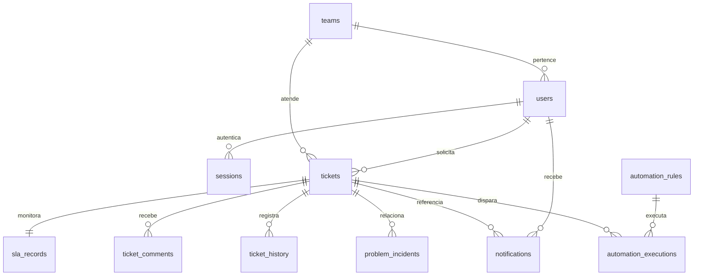

# Banco de dados

O SQLite é um arquivo persistente em `data/nexusops.db` no padrão local. A conexão habilita chaves estrangeiras, WAL e tempo de espera para lock. Migrations `.sql` são ordenadas pelo nome e registradas em `schema_migrations`; cada migration é aplicada em transação e não é reaplicada.

Incidente, problema e solicitação ficam na tabela `tickets` com tipo explícito e constraints de campos. `problem_incidents` valida que os tipos relacionados estão corretos, e um incidente só pode apontar para um problema. A participação de equipe nesta versão é uma relação direta `users.teamId`; associação de um usuário a múltiplas equipes não está implementada.

## Integridade e exclusão

Identificadores públicos utilizam contadores por tipo dentro de transação, além de constraint `UNIQUE` no número do chamado. Sessões usam hash do token como chave. Notificações possuem unicidade por usuário e evento; execuções de automação usam uma chave de deduplicação única.

Usuários referenciados como solicitantes ou autores de comentários têm exclusão restrita. O fluxo administrativo desativa contas em vez de apagar sua autoria. Relações secundárias como responsável e equipe podem ser anuladas quando a entidade correspondente é removida. Não há exclusão de chamados oferecida como operação normal na interface.

## Datas e SLA

Datas são strings ISO 8601 em UTC. Os prazos e metas são copiados para `sla_records`, mantendo a contagem independente da vida de uma página web. A data de primeira resposta e a data de resolução permitem calcular o cumprimento das duas metas.

## Índices

Migrations incluem índices para tipo/status, solicitante/data, equipe/responsável, datas de criação, comentários e histórico por chamado, prazos de SLA, sessões por expiração, notificações por usuário/leitura/data e execuções por data. Esses índices atendem a demonstração; cargas maiores requerem análise das consultas e plano de execução.

## Seed e migração

`npm run setup` aplica migrations e seed. `npm run db:migrate` pode ser executado novamente; migrations já registradas não são duplicadas. `npm run seed` prepara dados fictícios quando a base ainda está vazia. `npm run demo:reset -- --confirm`, com a aplicação parada, preserva o banco anterior em backup e gera uma demonstração nova.

A migração futura para PostgreSQL é roadmap. Ela exige mudanças no acesso a dados e nos scripts SQL; esta versão não finge compatibilidade de duas bases.
